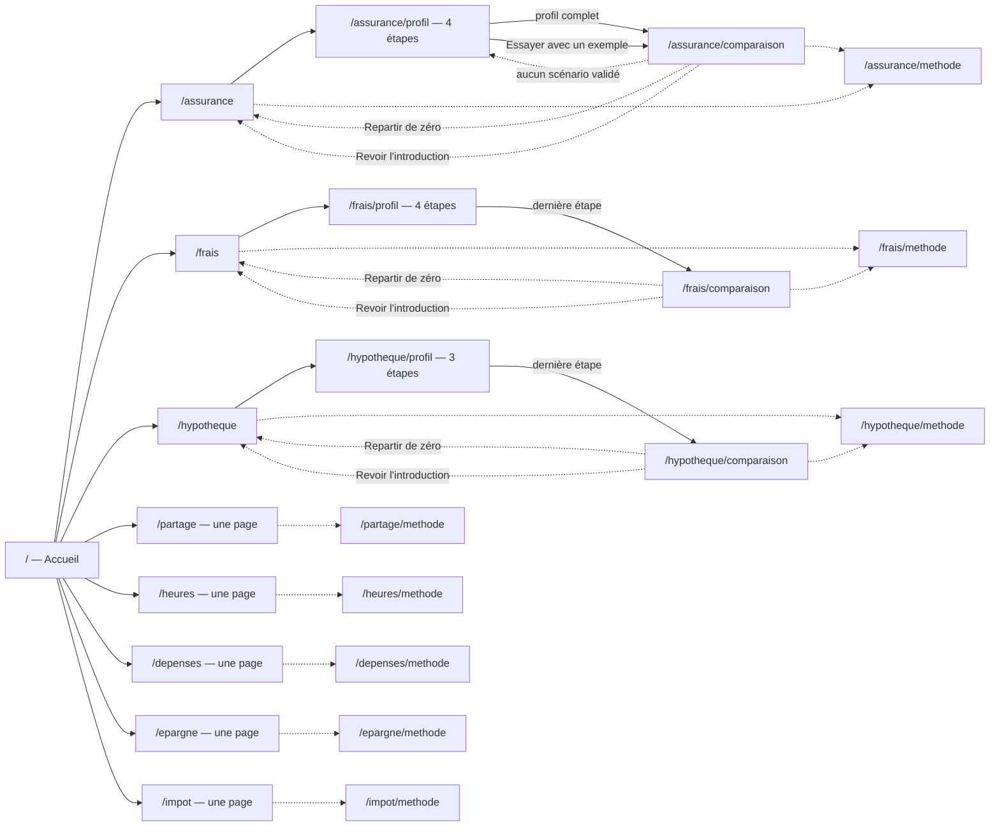

# Architecture

Application Angular 22 entièrement statique. Aucun appel réseau après le chargement : tout le calcul se fait dans le navigateur.

## Outils

L'application regroupe plusieurs **outils**. Chacun vit sous son propre préfixe d'adresse et dans son propre dossier, dans son propre morceau de code (`loadChildren`). Une fois la première page affichée, le routeur précharge les autres outils (`PreloadAllModules`, dans `app.config.ts`) : ce sont des fichiers du site lui-même, et on ouvre ensuite un outil sans attente.

```
src/app/
  app.routes.ts       routes de premier niveau, TitleStrategy
  home/               accueil : une carte par outil, groupées, puis « À propos »
  shell/              en-tête et pied de page communs (marque, menu des outils, menu mobile, soutien, « Vos données », liens vers les outils, le projet et GitHub)
  shared/             ce qui sert à plusieurs outils
    engine/           money.ts (Money, Account), formulas.ts, tax.ts, inflation.ts, rates.ts, pay.ts, limits.ts
    i18n/             catalogue : fr/common.ts, fr/home.ts, fr/assurance.ts, fr/fees.ts, fr/mortgage.ts,
                      fr/split.ts, fr/hours.ts, fr/spending.ts, fr/savings.ts, fr/marginal.ts, fr/privacy.ts
    figure/           montant cliquable et bulle de calcul
    number-input/     champs numériques (NumberField, NumberInput), money-input/ pour les dollars
    warning/          avertissement (variante insurance ou investing)
    charts/           couleurs et axe partagés des graphiques
    print/            impression et PDF des résultats
    reset/            bouton « Repartir de zéro »
    required-mark/    astérisque rouge après l'étiquette d'un champ obligatoire (« obligatoire » pour les lecteurs d'écran)
    stale/            résultats grisés, avec une note, tant qu'un champ obligatoire est vide
    storage/          lecture et écriture dans localStorage ; data-transfer.ts : le code d'export et d'import de /donnees
    page-notes/       notes en bas de chaque outil (où restent les chiffres, ce que l’outil n’est pas)
    doc-sections/     sections des pages de lecture (confidentialité, méthodes) : texte, liste, source, lien, formule MathML avec ses symboles (écrite à la main dans `<outil>/method/` : à mettre à jour avec le moteur)
    tool-links/       sous le titre de chaque outil : « Revoir l'introduction » et « Détails et sources »
    tool-breadcrumb/  fil d'Ariane au-dessus du titre (accueil, groupe, outil, page), avec le Breadcrumb de PrimeNG
    page-contents/    « Sur cette page » : un lien vers chaque section des longues pages de résultats
    contact.ts        adresse de contact et lien vers le code sur GitHub
    seo/              site.ts (SITE_URL ; NOINDEX et DOCS_BRANCH, tirés de la branche bâtie, build-branch.ts, généré), pages.ts (SITE_PAGES : chaque adresse, son titre, sa description), page-meta.ts (description, aperçu de lien, lien canonique et `robots` à chaque navigation)
    tools.ts          TOOLS et TOOL_GROUPS : les outils, rangés par thème (au quotidien, épargne et assurances), pour l'accueil et l'en-tête
    app-name.ts       APP_NAME, le nom affiché
  assurance/          outil permanente ou temporaire
  frais/              outil frais de gestion
  hypotheque/         outil temporaire ou assurance hypothécaire
  partage/            outil partage des dépenses selon les revenus
  heures/             outil prix en heures de travail
  depenses/           outil dépenses fréquentes (coût par année et coût d'opportunité)
  epargne/            outil épargne dans le temps (intérêts composés)
  impot/              outil taux marginal d'imposition au Québec
  confidentialite/    page de confidentialité
  donnees/            page /donnees : exporter ou importer les données gardées, avec un code à copier
  not-found/          page des adresses inconnues
  ressources/         page /ressources : une liste de lecture, avec ses données dans resources.data.ts
  sources/            page /sources : la liste des pages « Détails et sources » et les organismes publics cités
  dev/                développement seulement : les personas de docs/personas.md et `?persona=<id>`,
                      remplacé par une version vide au build de production (fileReplacements)
```

**Ajouter un outil** : un dossier `src/app/<outil>/` avec son `<outil>.routes.ts`, une entrée `loadChildren` dans `app.routes.ts`, une entrée dans `TOOLS`, et un fichier `shared/i18n/fr/<outil>.ts` ajouté à la fusion de `fr.ts`. Ce que l'outil garde sur l'appareil s'ajoute aussi à la page de confidentialité (`shared/i18n/fr/privacy.ts`, section « Données gardées dans votre navigateur »). Un outil n'importe jamais un autre outil : ce qui doit être partagé passe dans `shared/`.

## Pages et parcours



| Route                     | Composant             | Rôle                                                                                                                                                                                                                                       |
| ------------------------- | --------------------- | ------------------------------------------------------------------------------------------------------------------------------------------------------------------------------------------------------------------------------------------ |
| `/`                       | `home/`               | Hero (deux boutons qui descendent aux outils ou à « À propos »), les outils (une carte chacun), puis « À propos ».                                                                                                                         |
| `/assurance`              | `assurance/welcome/`  | Avertissement AMF, à quoi sert une assurance vie, à qui l'outil s'adresse, ce qu'il fait, ce qu'il faut avoir sous la main, ce qu'il faut vérifier. Aucun chiffre.                                                                         |
| `/assurance/profil`       | `assurance/profile/`  | Le formulaire en quatre étapes avec indicateur de progression.                                                                                                                                                                             |
| `/assurance/comparaison`  | `assurance/compare/`  | Les résultats, avec les paramètres modifiables à côté.                                                                                                                                                                                     |
| `/assurance/methode`      | `assurance/method/`   | Détails et sources, datés : principe, calcul, repères et leurs sources, limites. Lisible sans chiffres entrés.                                                                                                                             |
| `/frais`                  | `frais/welcome/`      | Avertissement, ce que l'outil calcule, à qui il s'adresse, ce qu'il faut avoir sous la main.                                                                                                                                               |
| `/frais/profil`           | `frais/profile/`      | Le formulaire frais en quatre étapes, prérempli avec les chiffres de départ.                                                                                                                                                               |
| `/frais/comparaison`      | `frais/page/`         | Les résultats, avec les paramètres modifiables à côté.                                                                                                                                                                                     |
| `/frais/methode`          | `frais/method/`       | Détails et sources, datés : principe, calcul, repères et leurs sources, limites. Lisible sans chiffres entrés.                                                                                                                             |
| `/hypotheque`             | `hypotheque/welcome/` | Avertissement, ce que l'outil compare, ce qu'il faut avoir sous la main.                                                                                                                                                                   |
| `/hypotheque/profil`      | `hypotheque/profile/` | Le formulaire en trois étapes (prêt, banque, temporaire), prérempli.                                                                                                                                                                       |
| `/hypotheque/comparaison` | `hypotheque/page/`    | Les résultats, avec les paramètres modifiables à côté.                                                                                                                                                                                     |
| `/hypotheque/methode`     | `hypotheque/method/`  | Détails et sources, datés : principe, calcul, règles et leurs sources, limites. Lisible sans chiffres entrés.                                                                                                                              |
| `/partage`                | `partage/page/`       | Une seule page : les salaires des deux personnes, le partage, « Net ou brut ? » et les explications.                                                                                                                                       |
| `/partage/methode`        | `partage/method/`     | Détails et sources, datés : principe, calcul, repères et leur source, limites. Lisible sans chiffres entrés.                                                                                                                               |
| `/heures`                 | `heures/page/`        | Une seule page : la paie, l'achat et le résultat en heures et en journées de travail.                                                                                                                                                      |
| `/heures/methode`         | `heures/method/`      | Détails et sources, datés : principe, calcul, taux de taxes et leur source, limites. Lisible sans chiffres entrés.                                                                                                                         |
| `/depenses`               | `depenses/page/`      | Une seule page : la dépense et sa fréquence, puis le rendement du placement à côté du résultat (coût par année, sur N ans, coût d'opportunité).                                                                                            |
| `/depenses/methode`       | `depenses/method/`    | Détails et sources, datés : principe, calcul, repères de rendement et d'inflation et leurs sources, limites. Lisible sans chiffres entrés.                                                                                                 |
| `/epargne`                | `epargne/page/`       | Une seule page : le placement, le départ retardé et les dollars d'aujourd'hui à côté du résultat, puis le graphique du solde.                                                                                                              |
| `/epargne/methode`        | `epargne/method/`     | Détails et sources, datés : principe, calcul, repères de rendement et d'inflation et leurs sources, limites. Lisible sans chiffres entrés.                                                                                                 |
| `/sources`                | `sources/`            | Détails et sources : la liste des pages `/<outil>/methode`, avec leur date, puis l'accueil des organismes publics cités. Lien dans le pied de page.                                                                                        |
| `/ressources`             | `ressources/`         | Pour aller plus loin : livres, sites, balados, outils, organismes et communautés, chacun avec un lien vérifié à la source. Finit par un lien vers `/sources`. Lien dans l'en-tête, le menu mobile et le pied de page.                      |
| `/confidentialite`        | `confidentialite/`    | La politique de confidentialité (Loi 25), sur le plan du guide de la Commission d'accès à l'information : renseignements recueillis, données gardées dans le navigateur, refus, tiers, conservation, responsable et droits, modifications. |
| `/donnees`                | `donnees/`            | Exporter ou importer vos données : un code à copier, un champ où coller un code. Lien dans le menu de l'avatar, le menu mobile et le pied de page.                                                                                         |

- Les textes de l'accueil sont dans `shared/i18n/fr/home.ts` : le hero (`home.title`, `home.lede`) porte la promesse du site, « Combien ça coûte, pour vrai ? », aujourd'hui et dans le temps ; « À propos » (`about.*`) dit pourquoi, puis la démarche en courts paragraphes, dont le code ouvert avec le lien vers les sources (`SOURCE_URL`, `shared/contact.ts`) ; elle finit par la phrase sur la gratuité du projet (`about.contact`). Le lien de soutien (`shared/support.ts`) sert à l'en-tête, au pied de page et à « À propos ».
- Une adresse inconnue affiche « Cette page n'existe pas » (`not-found/`, `path: '**'`), avec un lien vers l'accueil. L'adresse reste celle tapée. Le serveur, lui, répond toujours 200 avec `index.html`.
- `/profil` et `/comparaison`, les adresses d'avant le découpage, redirigent vers `/assurance/...`.
- `assurance/compare/comparison.guard.ts` renvoie vers `/assurance/profil` tant qu'aucun scénario complet n'existe. Le scénario étant gardé sur l'appareil, un rafraîchissement reste sur la comparaison. Son `welcomeGuard` saute l'introduction : vers la comparaison si un scénario existe, vers le profil (à l'étape quittée) s'il est commencé.
- `frais/page/fees.guards.ts` et `hypotheque/page/mortgage.guards.ts` font de même pour leur outil, selon `finished` et `started` de leur store.
- `/<outil>/introduction` (assurance, frais, hypothèque) affiche la même introduction sans la garde : c'est le lien « Revoir l'introduction » des résultats. Une fois les résultats faits, son bouton devient « Revenir à ma comparaison ».
- Au-dessus du titre des résultats, de l'introduction et de la méthode de chaque outil, `shared/tool-breadcrumb/` situe la page : Accueil › groupe › outil › page. La dernière étape est la page courante, sans lien. Le profil en étapes garde son indicateur « 1 sur 4 ».
- Sous l'en-tête des résultats de l'assurance, des frais et de l'hypothèque, `shared/page-contents/` liste les sections de la page (`contents` dans le composant de la page, un `id` sur chaque section). Un clic fait défiler jusqu'à la section et y place le focus ; l'adresse ne change pas. Le partage et les heures, plus courts, n'en ont pas.
- Sous le titre de chaque outil, `shared/tool-links/` mène à son introduction (s'il en a une) et à sa page « Détails et sources ». Le lien vers la méthode du bas de page reste.
- « Repartir de zéro » (`shared/reset/`) est le même bouton dans chaque outil : il demande confirmation, vide l'outil et ramène à son introduction.
- `app.routes.ts` déclare une `TitleStrategy` : le titre de chaque route est une clé du catalogue, traduite au moment d'afficher l'onglet, suivie de `APP_NAME`.
- Le routeur remet le défilement en haut à chaque changement de page (`withInMemoryScrolling`).
- Les fenêtres de confirmation et d'impression sont chargées à part (`@defer`), avec `prefetch on idle` : elles sont prêtes avant le premier clic.

Les sections qui suivent, jusqu'à « Outil frais de gestion », décrivent l'outil assurance ; les chemins sont relatifs à `src/app/assurance/`.

## État : `ScenarioStore`

`state/scenario.store.ts` tient deux choses :

- `draft` : le formulaire tel que la personne le remplit (`ScenarioForm`, où un champ vide vaut `null`) ;
- `committed` : le dernier scénario **complet** (`ScenarioInput`, sans `null`).

La comparaison n'affiche jamais que `committed`. Un champ obligatoire vidé ne devient donc jamais un 0 silencieux : la comparaison garde les derniers chiffres complets et nomme ce qui manque. Pendant ce temps, les résultats passent en gris sous une note (`shared/stale/`, le même composant dans chaque outil).

| Méthode            | Effet                                                                                                           |
| ------------------ | --------------------------------------------------------------------------------------------------------------- |
| `edit(next, live)` | Met à jour `draft`. En mode `live` (colonne de la comparaison), valide aussi le scénario dès qu'il est complet. |
| `commitDraft()`    | Valide le brouillon (fin du profil). Refuse s'il manque un champ.                                               |
| `useExample()`     | Charge l'exemple fictif et affiche le bandeau « exemple ».                                                      |

`projection` est un `computed` : `project(input)` est recalculé à chaque changement validé.

## Données gardées sur l'appareil

`shared/storage/device-storage.ts` lit et écrit dans `localStorage`, sous le préfixe `vraicout.`. Rien n'est envoyé ailleurs.

- `ScenarioStore` garde `draft`, `committed`, `illustrative` et `profileStep` (clé `vraicout.assurance`) ; `FeesStore` garde `draft`, `committed`, `profileStep` et `finished` (`vraicout.frais`) ; `MortgageStore` fait de même (`vraicout.hypotheque`) ; `SplitStore`, `HoursStore`, `SpendingStore`, `SavingsStore` et `MarginalStore` gardent `draft` et `committed` (`vraicout.partage`, `vraicout.heures`, `vraicout.depenses`, `vraicout.epargne`, `vraicout.impot`). Chaque store se recharge à sa création et s'enregistre par un `effect` à chaque changement.
- Chaque enregistrement porte un numéro de version (`VERSION`). À changer quand la forme d'un formulaire change : les anciens enregistrements sont alors ignorés plutôt que mal lus.
- Le thème (`vraicout.theme`, `shared/theme/`) est clair tant qu'on n'a pas choisi le sombre ; un script dans `index.html` l'applique avant le premier affichage.
- **Effacer vos données** (`shell/data-menu/`) : avatar à droite de l'en-tête, menu au survol de la souris, au clic ou au clavier. Après confirmation, tout ce qui porte le préfixe est effacé et la page se recharge sur l'accueil, ce qui remet chaque outil à zéro sans que l'en-tête dépende des outils.
- **Exporter ou importer vos données** (`/donnees`, `shared/storage/data-transfer.ts`) : tout ce qui porte le préfixe devient un objet JSON `{ app: 'vraicout', v: 1, keys: { <clé sans préfixe>: <valeur telle que gardée> } }`, encodé en base64 (en passant par UTF-8, pour les accents des prénoms). Le code se lit par quiconque l'a : il n'est pas chiffré, et la page le dit. Il ne sort du navigateur que par le presse-papiers, quand la personne clique sur « Copier le code ». À l'import, un code d'un autre site ou d'un autre format (`v`) est refusé ; un code valide, après confirmation, remplace tout ce qui est gardé (ce qu'il ne contient pas est effacé), puis la page se recharge sur `/donnees?importe`, parce que chaque store ne lit ses chiffres qu'à sa création. Une nouvelle clé gardée voyage donc toute seule ; changer la forme du code demande d'augmenter `FORMAT`.

## Le formulaire : de `ScenarioForm` à `ScenarioInput`

`engine/blank.ts` fait le pont entre ce que la personne tape et ce que le moteur reçoit.

- `missingFields(form)` liste les champs obligatoires manquants : âge, prime, montant au décès, années de primes, prime et montant de la temporaire, et l'année de début du contrat quand des lignes sont repérées en années de contrat.
- `toScenarioInput(form)` remplace les champs facultatifs vides par 0 et convertit les lignes du tableau de valeurs en âges.
- L'âge peut être donné par l'année de naissance. `currentAge` reste alors toujours à jour, pour que le reste du code ne dépende que de lui.
- Les lignes du tableau de valeurs (`FormAnchor`) gardent ce que la personne a tapé, dans l'unité choisie : âge, année ou année du contrat. Elles ne sont converties en âge qu'à l'entrée du moteur, pour qu'une année tapée ne bouge pas si l'âge change.
  - `anchorAge`, `anchorAt` et `rowAge` font les conversions.
  - Une ligne qui ne peut pas encore être convertie (années de contrat sans année de début) garde son âge dans `pendingAge`.
  - `plausibleStart` ignore une année de début en cours de frappe (« 2 », « 20 »…).

## Le composant formulaire (`drawer/`)

Un seul composant sert partout, découpé en sections : `profile`, `permanent`, `anchors`, `term`, `params`, `display`.

| Entrée     | Valeurs                                                                                                     |
| ---------- | ----------------------------------------------------------------------------------------------------------- |
| `mode`     | `draft` sur la page profil, `live` dans la colonne de la comparaison.                                       |
| `sections` | Sections affichées. Le profil en montre une ou deux par étape ; la comparaison les montre toutes.           |
| `errors`   | Force l'affichage des erreurs. Le profil ne les montre qu'après une tentative de passer à l'étape suivante. |

Toutes les modifications passent par `edit()`, qui clone le formulaire, applique le changement et appelle `store.edit`.

## Le profil en étapes (`profile/`)

Le tableau `STEPS` décrit les quatre étapes : titre, libellé court pour l'indicateur, phrase d'introduction, sections et champs obligatoires.

- **« Suivant »** ne valide que les champs de l'étape. S'il en manque, il les nomme et place le curseur sur le premier.
- **L'indicateur** est le Stepper de PrimeNG, réduit à sa liste d'étapes ; le contenu est rendu par le profil lui-même. Une étape n'est accessible que si les précédentes sont complètes.
- **Au changement d'étape**, la page remonte et le focus va au titre de l'étape, pour les lecteurs d'écran.

## La comparaison (`compare/`)

De haut en bas :

1. En-tête et puces d'hypothèses : fin de la temporaire, fin des primes, horizon, rendement, part placée, compte, dollars d'aujourd'hui.
2. `milestones/` : le champ « À quel âge ? » et ses raccourcis (les âges repères), puis « En bref », un tableau à deux colonnes (en vie, au décès, primes) avec l'écart sous chaque ligne, le rendement d'équilibre et « À savoir ». L'âge choisi est dans le store (`focus`) et les graphiques le marquent.
3. `charts/` : « si vous décédez » et « si vous êtes en vie ». Chaque option y a le même total que dans « En bref » et dans le tableau (`forHeirs`, `inHand`, calculés par le moteur) ; le pointillé marque une variante de la permanente (participations, valeurs garanties). L'infobulle détaille chaque total. La courbe de la temporaire tombe verticalement à sa fin.
4. `narratives/` : avantages et limites de chaque option, accès à la valeur de rachat, « Et après la temporaire ? ».
5. `pedagogy/` : fonctionnement d'une permanente, lexique, puis un lien vers la méthode.
6. `matrix/` : année par année.

`method/` est la page `/assurance/methode`, sans garde, bâtie comme celle des frais. C'est là que vivent les sources de l'outil.

La colonne de paramètres apparaît à gauche dès 960 px, et peut se replier. En dessous, un bouton fixe ouvre un tiroir.

### Champs numériques (`shared/number-input/`, `shared/money-input/`)

- `NumberField` est la base commune : le nombre nu pendant la saisie (`1000,5`), formaté à la sortie, une virgule ou un point lus comme séparateur décimal, et les bornes `min` et `max`. Quand un nombre tapé est ramené à une borne, une note sous le champ le dit (« Maximum : 60 ans. »), reliée au champ par `aria-describedby`. `MoneyInput` l'affiche en dollars (« 1 000 $ »), `NumberInput` avec une unité (« 2,5 % », « 65 ans », « 37,5 h ») ou en année sans espace (« 1985 »).
- Seul le compteur d'année du résumé hypothécaire, avec ses boutons + et −, reste un `p-inputnumber` de PrimeNG.
- Les bornes de chaque champ viennent du `engine/limits.ts` de l'outil : voir [Limites des champs](limites-des-champs.md).

### Montants et bulle de calcul (`shared/figure/`)

- `app-figure` affiche un `Money` (voir [Modèle de calcul](modele-de-calcul.md)) sous forme de bouton.
- Une **seule** bulle (`formula-popover.ts`) sert toute la page, pilotée par `FormulaService` : survol au pointeur, clic ou Entrée pour l'épingler, clic ailleurs ou Échap pour la fermer. Une seule formule est ouverte à la fois, même avec quelque 380 montants dans la page.

### Matrice

La matrice mesure **sa propre largeur** (`ResizeObserver`) plutôt que celle de la fenêtre :

- **900 px de large ou plus :** tableau groupé par option ;
- **en dessous :** accordéon, une année par panneau. Seule l'année ouverte affiche ses montants.

C'est ce qui évite les chiffres qui se chevauchent quand la colonne de paramètres est ouverte.

## Outil frais de gestion (`frais/`)

Même parcours que l'assurance (introduction, quatre étapes, résultats), mais le formulaire s'ouvre sur des chiffres ronds (un fonds commun à 2,2 % contre un FNB indiciel à 0,25 %) au lieu de champs vides. Calcul détaillé dans [Modèle de calcul : frais de gestion](modele-de-calcul-frais.md).

- `state/fees.store.ts` : même patron que `ScenarioStore`. `draft` (formulaire, champs vides à `null`), `committed` (dernier calcul complet), `projection`, `profileStep` (étape en cours) et `finished` (étapes terminées ; une sauvegarde d'avant les étapes compte comme terminée). Un champ obligatoire vidé garde les derniers chiffres et le nomme.
- `engine/blank.ts` : `FeesForm`, `defaultFeesForm()`, `missingFeesFields()`, `toFeesInput()`.
- `page/` : même mise en page que la comparaison (colonne de paramètres dès 960 px, tiroir en dessous).
- `fees-form/` se découpe par `sections` comme `assurance/drawer/` ; `profile/` et `welcome/` reprennent les classes de leurs équivalents assurance.
- `fees-summary/` (deux cartes alignées en `subgrid` et « En bref »), `fees-chart/` (A, B et la référence sans frais en pointillé, ligne de la retraite), `fees-pedagogy/` (les leçons, puis un lien vers la méthode), `fees-table/` (tableau année par année, replié par défaut, qui défile dans son propre conteneur).
- `method/` : la page `/frais/methode`, sans garde. Elle se découpe en sections de morceaux typés (`shared/doc-sections/`, comme la page de confidentialité) ; un morceau `source` se place juste sous le paragraphe qu'il appuie. C'est là que vivent les sources de l'outil.

## Outil assurance hypothécaire (`hypotheque/`)

Compare une assurance temporaire personnelle à l'assurance vie hypothécaire de la banque, pour une personne ou un couple. Même parcours que l'outil frais, en trois étapes (prêt, banque, temporaire), sur des chiffres de départ ronds. Calcul détaillé dans [Modèle de calcul : assurance hypothécaire](modele-de-calcul-hypotheque.md).

- `state/mortgage.store.ts` : même patron que `FeesStore` (clé `vraicout.hypotheque`). Garde aussi l'année et la personne regardées pour un décès (`deathYear`, `deathPerson`) ; `year` ramène l'année dans la durée du prêt, `death` en tire les montants (`deathAt`).
- `engine/blank.ts` : `MortgageForm`, `defaultMortgageForm()`, `missingMortgageFields()` (la deuxième personne n'est exigée qu'en couple), `toMortgageInput()`.
- `mortgage-form/` se découpe en sections `loan`, `bank`, `term`. Activer le couple fait passer la prime de départ de la banque de 40 $ à 70 $, tant que la personne ne l'a pas changée.
- `mortgage-summary/` : choix de l'année (et de la personne en couple), deux cartes en `subgrid`, « En bref ». `mortgage-chart/` : ce que verse chaque assurance par année, en escalier pour la temporaire, avec une ligne sur l'année choisie. `mortgage-differences/` : le tableau qualitatif (bénéficiaire, protection, portabilité, couple, fin du prêt), empilé sur téléphone. `mortgage-pedagogy/`, `mortgage-table/`, `print-params/`.
- `method/` : la page `/hypotheque/methode`, sans garde, bâtie comme celle des frais. C'est là que vivent les sources de l'outil.
- `person-name.ts` : le prénom tapé, ou « Personne 1 » / « Personne 2 ».
- `app-figure` accepte `[exact]="true"` pour afficher les cents (primes mensuelles).

## Outil partage des dépenses (`partage/`)

Calcule la part de chaque personne dans les dépenses communes, au prorata de son revenu. Une seule page, sans introduction ni étapes : le formulaire et le résultat sont ensemble, et le résultat suit la frappe. Un seul champ de salaire par personne, brut ou net au choix ; la section « Net ou brut ? » explique les deux et demande le même type pour les deux personnes. Calcul détaillé dans [Modèle de calcul : partage des dépenses](modele-de-calcul-partage.md).

- `state/split.store.ts` : `draft` et `committed`, comme les autres outils, sans `finished` ni `profileStep`.
- `engine/blank.ts` : `SplitForm`, `defaultSplitForm()`, `missingSplitFields()` (les deux salaires, pas tous deux à 0), `toSplitInput()`. Les fréquences de paie et `withFrequency()` (changer la fréquence convertit le salaire, au cent près, et au dollar près pour l'année) sont dans `shared/engine/pay.ts`, partagées avec l'outil heures.
- `engine/split.ts` : `splitIncomes()`.
- `method/` : la page `/partage/methode`, sans garde, bâtie comme celle des frais. Le lien est au bas de « Précisions ».
- `page/` : deux colonnes (une par personne), puis la facture facultative à côté de la carte du partage (empilées sous 760 px), « Net ou brut ? » et « Bon à savoir ». Les deux personnes ont leurs couleurs (`--split-p1`, `--split-p2`, alias de `--fee-a` et `--fee-b`) sur la barre de partage et la légende, jamais sur du texte.

## Outil prix en heures de travail (`heures/`)

Convertit un prix en heures et en journées de travail, selon la paie nette, après ce que le travail coûte. Une seule page, sur le modèle du partage : la paie en haut, puis l'achat à côté de la carte du résultat (empilés sous 760 px). Calcul détaillé dans [Modèle de calcul : prix en heures de travail](modele-de-calcul-heures.md).

- `state/hours.store.ts` : `draft` et `committed`, comme le partage.
- `engine/blank.ts` : `WorkForm`, `defaultWorkForm()`, `missingWorkFields()` (paie, heures et prix ; des frais qui dépassent la paie sont signalés), `toWorkInput()`.
- `engine/hours.ts` : `hoursOfWork()`. Les heures et les journées sont des `Money` dont la formule finit par `{result}`, formaté à une décimale.
- `app-figure` accepte `unit="hours"` ou `unit="days"` pour ces durées.
- `method/` : la page `/heures/methode`, comme celle du partage. C'est là que vit la source des taux de taxes.

## Outil dépenses fréquentes (`depenses/`)

Ramène une dépense qui revient souvent à l'année, la projette sur plusieurs années (prix fixes ou qui montent avec l'inflation), et montre son coût d'opportunité : ce que les mêmes sommes vaudraient placées chaque mois. Une seule page, sur le modèle des heures : la dépense en haut, puis le rendement à côté de la carte du résultat (empilés sous 760 px). Calcul détaillé dans [Modèle de calcul : dépenses fréquentes](modele-de-calcul-depenses.md).

- `state/spending.store.ts` : `draft` et `committed`, comme les heures.
- `engine/types.ts` : les six fréquences (`Cadence` : « X fois par jour », « aux X jours »…) et `PERIODS_PER_YEAR` (365 jours, 52 semaines, 12 mois).
- `engine/blank.ts` : `SpendingForm`, `defaultSpendingForm()`, `missingSpendingFields()` (montant, X, années, rendement), `toSpendingInput()`.
- `engine/spending.ts` : `spendingCost()`. Le placement suit la convention de l'épargne : taux effectif annuel converti en taux mensuel (`shared/engine/rates.ts`), dépôt à la fin du mois après l'intérêt.
- `method/` : la page `/depenses/methode`, avec les mêmes sources que l'épargne (normes de l'IQPF et de FP Canada, inflation de la Banque du Canada).

## Outil épargne dans le temps (`epargne/`)

Montre l'effet des intérêts composés sur un placement : des dépôts mensuels pendant quelques années, puis des années de croissance sans dépôt, et le même placement commencé plus tard. Une seule page, sur le modèle des heures : le placement en haut, puis le départ retardé et les dollars d'aujourd'hui à côté de la carte du résultat (empilés sous 760 px), et le graphique. Calcul détaillé dans [Modèle de calcul : épargne dans le temps](modele-de-calcul-epargne.md).

- `state/savings.store.ts` : `draft` et `committed`, comme les heures.
- `engine/blank.ts` : `SavingsForm`, `defaultSavingsForm()`, `missingSavingsFields()` (un montant, des années de dépôts, un rendement ; une attente qui dépasse les années de dépôts est signalée), `toSavingsInput()`.
- `engine/growth.ts` : `projectSavings()`. Le rendement est un taux effectif annuel, converti en taux mensuel équivalent, comme dans l'assurance et les frais (`shared/engine/rates.ts`). La part des intérêts est un `Money` en pourcentage, affiché par `app-figure` avec `unit="percent"`.
- `savings-chart/` : le solde par année en deux bandes empilées (versé, intérêts), plus le départ retardé en tirets. Couleurs `--savings-deposited`, `--savings-interest` et `--savings-late`, alias de séries déjà validées.
- `method/` : la page `/epargne/methode`, comme celle des heures, avec les sources du rendement (normes de l'IQPF et de FP Canada) et de l'inflation.

## Outil taux marginal d'imposition (`impot/`)

Calcule le taux d'impôt sur le prochain dollar de revenu imposable au Québec, fédéral (après l'abattement du Québec) et provincial, l'impôt de l'année, le taux moyen et l'impôt sur un revenu de plus. Une seule page, sur le modèle de l'épargne : le revenu à côté de la carte du résultat (empilés sous 760 px), puis le graphique et le tableau des tranches. Calcul détaillé dans [Modèle de calcul : taux marginal d'imposition](modele-de-calcul-impot.md).

- `state/marginal.store.ts` : `draft` et `committed`, comme l'épargne.
- `engine/blank.ts` : `MarginalForm`, `defaultMarginalForm()`, `missingMarginalFields()` (seul le revenu est obligatoire ; un revenu de plus vide veut dire aucun), `toMarginalInput()`.
- `engine/brackets.ts` : les tranches, les montants personnels de base et l'abattement de 2026 (`TAX_YEAR`), avec la source de chaque chiffre. Les textes de la page Méthode et d'autres outils les recopient : la liste complète est dans [Chiffres annuels](chiffres-annuels.md).
- `engine/marginal.ts` : `marginalRate()` et `totalTax()`. Les taux sont des `Money` en pourcentage, affichés avec `unit="percent"`. Les marches du graphique sont calculées par les mêmes fonctions qu'un revenu entré.
- `rate-chart/` : l'escalier du taux combiné (`stepped`, axe des revenus linéaire jusqu'à `CHART_MAX`), un trait plein au revenu et un pointillé avec le revenu de plus, puis un tableau repliable des tranches. Couleur `--marginal-rate`, alias de `--term-series` en clair ; en sombre, un cran plus foncé (`#29ab93`) pour rester dans la bande de clarté du validateur dataviz.
- `method/` : la page `/impot/methode`, avec la formule MathML (`marginal-formula.html`) et les sources (ministère des Finances du Québec, ARC, TD1-WS).

## Mise en page

- Une seule feuille de style globale (`src/styles.css`), avec des variables de couleur : `--keep` pour la permanente, `--term` pour la temporaire, `--fee-a` et `--fee-b` pour les deux placements de l'outil frais, `--mortgage-term` et `--mortgage-bank` (alias de `--term-series` et `--keep`) pour l'outil hypothécaire.
- Les graphiques et les bordures des cartes utilisent `--term-series` (`#00846f`) plutôt que `--term` : le turquoise de marque est trop peu saturé pour une série. Les couleurs des séries (`--keep`, `--extra`, `--term-series`, `--fee-a`, `--fee-b`) ont été validées avec le script du skill dataviz (séparation pour les daltoniens, vision normale, contraste). Une couleur de série ne colore jamais du texte. `--extra` (épargne supplémentaire) est un gris neutre, choisi au validateur pour rester distinct des deux séries ; il n'a pas de saturation, à dessein.
- L'en-tête commun colle en haut de l'écran (`position: sticky` sur l'hôte `app-shell`). `Shell` publie sa hauteur dans `--app-bar-h` (`ResizeObserver`) : la colonne de paramètres colle juste dessous, et `scroll-padding-top` garde les sections et les champs atteints par le défilement hors de sa portée. Sous 1 100 px, il tient sur deux rangées : la marque, le soutien (« Soutenir » sous 640 px) et l'avatar, puis les liens des outils sur une ligne qui défile de côté et se place sur l'outil courant.
- Mobile d'abord ; aucun défilement horizontal de 320 à 1920 px. Seul le tableau de la matrice peut défiler dans son propre conteneur.
- Les cartes du comparatif (frais, hypothèque) utilisent `subgrid`, pour que chaque chiffre fasse face à son équivalent. L'assurance utilise un vrai tableau (`.versus`), une colonne par option.
- `styleClass` n'est pas appliqué par `p-message` dans PrimeNG 22 (constaté) : on met `class` sur l'élément hôte, et on fait de même pour `p-slider` et `p-chip` par prudence.

## Textes

Toute chaîne visible passe par `I18nService.t(clé, paramètres)`. Les clés sont typées (`MessageKey`) : une clé inconnue ne compile pas. Voir [Règles de rédaction](redaction.md).

## Tests

| Fichier                                                                                  | Ce qu'il verrouille                                                                                                                                                                                                                                                                                       |
| ---------------------------------------------------------------------------------------- | --------------------------------------------------------------------------------------------------------------------------------------------------------------------------------------------------------------------------------------------------------------------------------------------------------- |
| `assurance/engine/project.spec.ts`                                                       | Budget égal, police libérée, impôt selon le compte, dollars d'aujourd'hui, rendement d'équilibre, explication de chaque montant.                                                                                                                                                                          |
| `assurance/engine/interpolate.spec.ts`                                                   | Interpolation des valeurs de rachat.                                                                                                                                                                                                                                                                      |
| `assurance/engine/blank.spec.ts`                                                         | Conversions âge, année et année du contrat ; champs obligatoires.                                                                                                                                                                                                                                         |
| `assurance/state/scenario.store.spec.ts`                                                 | Un champ vidé ne remplace pas le dernier scénario complet.                                                                                                                                                                                                                                                |
| `frais/engine/fees.spec.ts`                                                              | Formule fermée, rendement et frais en taux effectifs, référence sans frais, impôt partagé, REER, dollars d'aujourd'hui, retraits qui vident le placement, explication de chaque montant.                                                                                                                  |
| `hypotheque/engine/mortgage.spec.ts`                                                     | Amortissement canadien, solde qui descend à zéro, temporaire qui tombe à sa fin, part du prêt qui reste selon l'année, couple (un seul versement de la banque, la temporaire du survivant), explication de chaque montant.                                                                                |
| `hypotheque/state/mortgage.store.spec.ts`                                                | Champ vidé, année choisie gardée et ramenée dans le prêt, reprise à l'étape, remise à zéro.                                                                                                                                                                                                               |
| `frais/state/fees.store.spec.ts`                                                         | Un champ vidé ne remplace pas le dernier calcul complet ; reprise à l'étape quittée ; ancienne sauvegarde traitée comme terminée ; remise à zéro.                                                                                                                                                         |
| `partage/engine/split.spec.ts`                                                           | Fréquences de paie ramenées à l'année, partage, arrondis au point et au 5, facture, revenu à 0, explication de chaque montant.                                                                                                                                                                            |
| `partage/state/split.store.spec.ts`                                                      | Champ vidé, reprise à la visite suivante, remise à zéro, sauvegarde de la première version ignorée.                                                                                                                                                                                                       |
| `heures/engine/hours.spec.ts`                                                            | Prix en heures et en journées, taxes au choix, frais de travail retirés de la paie, prix mensuel ou annuel, aucune division par zéro, explication de chaque montant.                                                                                                                                      |
| `heures/state/hours.store.spec.ts`                                                       | Champ vidé, reprise à la visite suivante, remise à zéro.                                                                                                                                                                                                                                                  |
| `depenses/engine/spending.spec.ts`                                                       | Chiffres de départ calculés à la main, les six fréquences, boucle mensuelle égale à la formule fermée, prix qui montent, rendement nul, dépense gratuite, explication de chaque montant.                                                                                                                  |
| `depenses/state/spending.store.spec.ts`                                                  | Champ vidé, reprise à la visite suivante, remise à zéro.                                                                                                                                                                                                                                                  |
| `epargne/engine/growth.spec.ts`                                                          | Chiffres de départ et départ retardé, taux effectif (le cas des 92 $ par mois à 7 %), boucle mensuelle égale aux formules fermées, montant de départ seul, sans croissance ni comparaison, rendement nul, dollars d'aujourd'hui, explication de chaque montant.                                           |
| `impot/engine/marginal.spec.ts`                                                          | Chiffres de départ, taux de chaque tranche, seuil exact, début de l'impôt après le montant personnel, baisse du montant personnel fédéral, taux égal à l'impôt d'un dollar de plus, revenu de plus qui franchit un seuil, revenu nul, marches du graphique, explication de chaque montant.                |
| `impot/state/marginal.store.spec.ts`                                                     | Champ vidé, revenu de plus vide, reprise à la visite suivante, remise à zéro.                                                                                                                                                                                                                             |
| `epargne/state/savings.store.spec.ts`                                                    | Champ vidé, reprise à la visite suivante, remise à zéro.                                                                                                                                                                                                                                                  |
| `shared/engine/pay.spec.ts`                                                              | Plafond de la paie, qui reste sous le plafond annuel quand la fréquence change.                                                                                                                                                                                                                           |
| `shared/engine/rates.spec.ts`                                                            | Taux mensuel équivalent au taux effectif annuel.                                                                                                                                                                                                                                                          |
| `*/print-params/*.spec.ts`, `shared/print/print.service.spec.ts`                         | Paramètres repris à l'impression, impression des résultats.                                                                                                                                                                                                                                               |
| `shared/number-input/`, `shared/money-input/`, `shared/rich-text/`, `shell/mobile-menu/` | Champs numériques, gras et italique des textes, menu mobile.                                                                                                                                                                                                                                              |
| `app.spec.ts`                                                                            | Accueil et liste des outils, anciennes adresses, garde, introductions accessibles depuis les résultats, liens sous le titre, fil d'Ariane, sommaire des résultats, page des adresses inconnues, validation de la première étape du profil, page `/sources` et méthodes des outils lisibles sans chiffres. |
| `ressources/resources.data.spec.ts`                                                      | Ressources : aucune section vide, aucune entrée en double, liens en `https` et sans site d'affiliation.                                                                                                                                                                                                   |
| `shared/i18n/i18n.spec.ts`                                                               | Le catalogue anglais a exactement les clés du français.                                                                                                                                                                                                                                                   |

Le parcours a aussi été vérifié dans un vrai navigateur (Playwright), mais ces scripts ne sont pas encore dans le dépôt.
